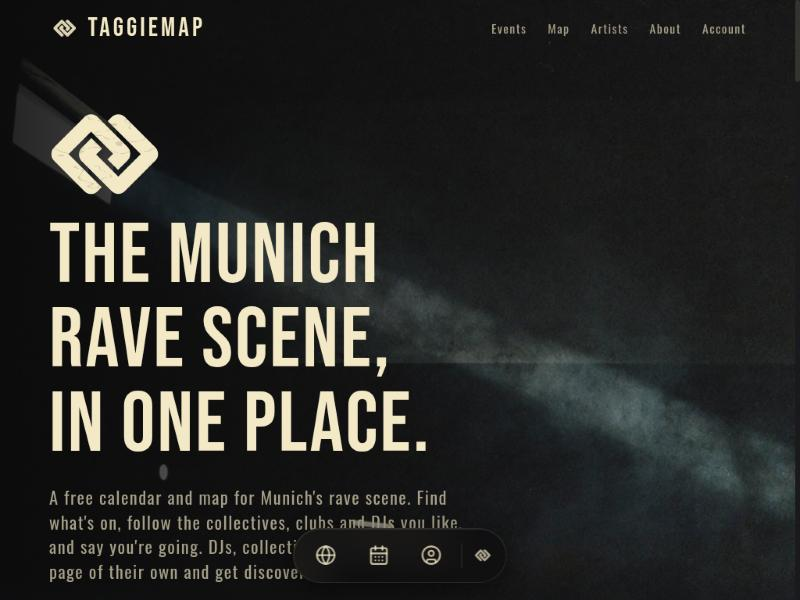
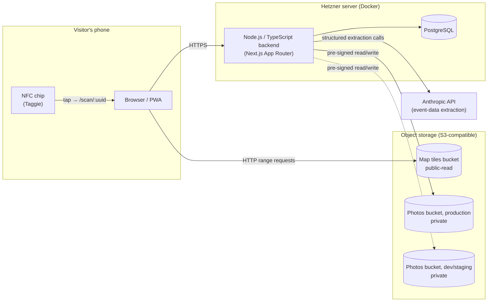
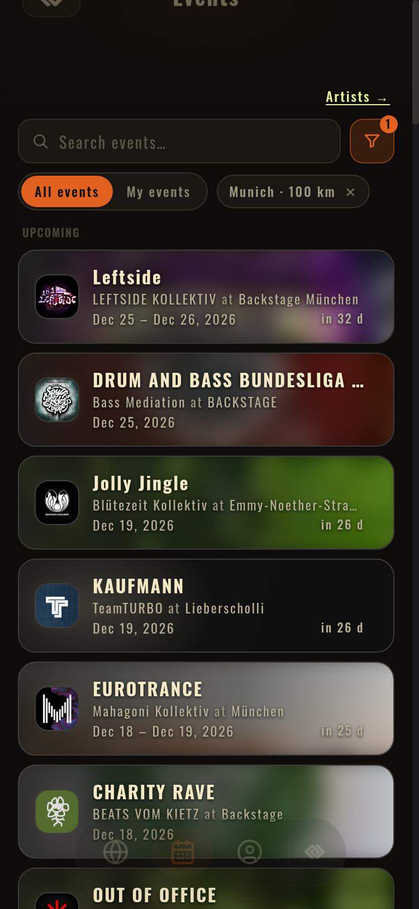
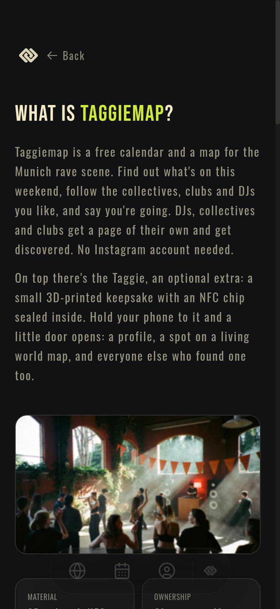

# Taggiemap: Engineering Write-up

> This repository contains no source code. It's a write-up of the engineering behind
> [taggiemap.de](https://taggiemap.de): how the system is built, the problems it runs
> into, and the decisions behind it.

## Contents

1. [What is Taggiemap](#1-what-is-taggiemap)
2. [What else is in the platform](#2-what-else-is-in-the-platform)
3. [Architecture](#3-architecture)
4. [Turning flyers into calendar data](#4-turning-flyers-into-calendar-data)
5. [Design decisions and tradeoffs](#5-design-decisions-and-tradeoffs)
6. [The Taggies themselves](#6-the-taggies-themselves)
7. [Status and next steps](#7-status-and-next-steps)
8. [Where the time actually went](#8-where-the-time-actually-went)
9. [Stack](#9-stack)

## 1. What is Taggiemap

Taggiemap connects a physical object to a digital community. You get a small
3D-printed cat ("Taggie") with an NFC chip embedded in it, as a gift. You scan
it with your phone, and it becomes your key to a profile, a world map of
everyone else's Taggies, and full participation in the local
electronic-music event calendar. You don't need one to use the calendar at
all: an email-only account already gets you browsing, planning, and
notifications. What the Taggie adds is the social layer: showing up on the
map, in event chat, in connections. That's the part that's tied to having
actually been somewhere in person.

It's a solo project. I've been building it since May 2026, alongside a full-time
job, and it is live and in daily use: it runs the event calendar for the Munich
electronic-music scene, with 80 events listed for October 2026, 181 events on the
platform overall, 143 organizers (collectives, clubs, venues) with their own
page, 61 registered accounts and 518 physical Taggies made so far (198 of them
claimed).
A growing share of new events arrive through an automated pipeline that reads
public event announcements with an LLM rather than being typed in by hand
(more on that below).

This write-up goes deep on three things: how I turn messy, unstructured event
announcements into structured calendar data with an LLM (§4); the tradeoffs
behind running my own infrastructure instead of defaulting to managed services
(§5); and the physical/digital bridge, NFC → web app (§3, §6). §2 is a quick
map of everything else that's actually built, so this doesn't read as if
that's all there is.

## 2. What else is in the platform

The NFC-to-profile loop and the calendar (§1) are the core, but they're a
deliberately narrow cut of a much bigger app. Briefly, what else is live:

- **Community / social:** a handle and profile for every account, friend
  requests by link or QR code, a passive "crossed paths" count computed from
  shared event history (no action needed, it just accumulates), pokes, and
  star ratings with comments on events and artists after the fact.
- **Artist platform** (built, rolling out gradually behind feature flags):
  its own account type with a profile builder (links, short facts, press
  kit, residencies), a public directory, an availability calendar, and
  direct booking requests from organizers.
- **Organizer area:** self-service event and lineup management, member roles
  and invite links, a moderation panel, a statistics view, and the review
  queue for events the import pipeline (§4) suggests.
- **Notifications:** a subscribable bell on any artist, venue, event or
  organizer, push and email delivery, quiet hours and a daily-digest option,
  everything collected into one inbox.
- **Content moderation:** reports on messages, profiles, ratings and events
  route to the organizer or admin responsible, with hide/block actions at
  both levels, enforced regardless of which feature flags are on.
- **Admin tooling:** bulk-editable lists with saved filters across every
  entity, visitor and funnel stats, and a weekly automated Instagram
  carousel ("Wochenpost") that drafts itself from the coming weekend's
  events for one approval click.
- **Discovery:** genres, a searchable public events list, venue pages that
  cluster nearby Taggies, and an in-app help overlay aware of which page and
  role is looking at it.

None of this is covered in depth here; it's listed to be honest about scope,
not glossed over.

## 3. Architecture

The whole product runs on a single Hetzner server: a Node.js/TypeScript backend
(Next.js, server-rendered), PostgreSQL for all application data, and three
object-storage buckets: one public-read for the map's vector tiles (fetched
straight from the browser as HTTP range requests, so the server never sits in
that hot path), and two private ones for user photos, kept apart by
environment (production vs. development/staging) so test uploads can never
end up mixed into real user data. The map itself is a self-hosted tile set,
not a paid map provider (see §5 for why). Event data comes in two ways:
organizers can enter it by hand, or it is extracted from public event
announcements using an LLM (§4). The NFC flow is simple by design: tapping a
Taggie opens a URL with an embedded ID, which the backend resolves to either a
claim flow (new Taggie) or the owner's profile (claimed one). No app to
install.

## 4. Turning flyers into calendar data

This is the part of the system I'd most want a technical reader to look at closely.

Electronic-music collectives announce almost everything as an Instagram flyer
image with a caption, not as structured data anywhere. Taggiemap needs real
dates, venues, and lineups. So there's a pipeline that reads a flyer image and
its caption and turns it into a typed, validated event, and nothing from that
pipeline ever goes live without a human (the organizer or an admin) confirming
it first. Event data itself is sourced from public event announcements; this
write-up deliberately doesn't describe how the data is retrieved: that's not
the interesting (or safe-to-publish) part. What's interesting is what happens
once an announcement is in front of the model.

**The pipeline, per announcement:**

1. **One extraction call.** A smaller Anthropic model is sent the image(s) plus
   the caption text, today's date, and the date the post was published. The
   call is forced to answer through a single tool call rather than free-form
   text, so the output is a fixed JSON shape, not something I have to parse out
   of prose.
2. **Schema validation (zod).** The tool output is validated against a strict
   schema before anything touches it: dates must be `YYYY-MM-DD`, times must be
   `HH:mm` in 24h format, lineup entries are capped in count and string length.
   Anything that doesn't fit the schema is either dropped field-by-field
   (a malformed time costs that one field, never the whole event) or the event
   is discarded entirely if it has no date at all. There's no silent repair
   that could insert guessed data.
3. **Deterministic post-processing in code, not the model.** A second layer of
   plain functions re-checks what the model read, because a few mistakes are
   systematic enough to catch reliably without another AI call:
   - **Tags are not names.** Flyers print Instagram handles (`@kolter`), and
     models like to "clean up" a handle into something that looks like a
     proper name. The code cross-checks every lineup entry against the actual
     `@mentions` in the caption; anything that looks like a handle (leading
     `@`, or a single word containing digits/dots/underscores that matches a
     caption mention) is forced back into the handle field and the name is
     cleared, rather than trusted as a human name the model inferred from a
     tag.
   - **Placeholder slots aren't artists.** "Special Guest", "TBA", "Secret Act"
     and the German/English equivalents are a known closed list; a slot
     matching one of them is flagged as a placeholder, not created as a fake
     performer in the lineup.
   - **A door time bleeding into every set.** Flyers sometimes print one clock
     time once (the doors time) next to a stacked list of names, and the model
     would attach that same time to every single act as if each of them had
     its own, identical start time. A heuristic (same time across ≥2 real
     acts, not each on its own clearly separate stage) reassigns that time to
     the event's own start and strips it back off the acts.
   - **Set time vs. event time.** The model is asked separately whether the
     *event's* start/end time was actually printed as such, as opposed to only
     a set time for one act being visible: a first act listed at 23:00 does
     not mean the event starts at 23:00.
4. **Timezones and multi-day events.** Flyers print dates without a year
   constantly ("Sat, Oct 3"). The resolution rule is explicit: pick the next
   occurrence of that date on or after the post's own publish date (falling
   back to "today" when the publish date isn't known), never the current year
   blindly: otherwise a flyer posted in December for a January date would
   silently land a year early. For multi-day events (a festival Friday to
   Sunday), the model is additionally asked which *calendar day* each act's
   clock time falls on, because a set at 01:00 printed under the "Saturday"
   heading is actually early Sunday morning: treating it as Saturday would
   put it before the acts that came earlier that same printed day.
5. **Duplicates.** A second flyer for an event already seen isn't a new event:
   it's a correction or an addition (fill in a missing field, extend a lineup,
   or override a start time if the two disagree, always keeping the newer
   post's value and recording what changed). The matching is deliberately
   conservative: same organizer, same calendar day, and either an explicit
   match the model is confident about or a similar name within a day. Same
   venue alone is never enough: two different parties at the same club on the
   same night are two events, not one.
6. **Safety classification happens in the same call.** The schema also asks
   the model to flag passages suggesting extremism, hate, illegal activity,
   violence, sexual content, closed/invite-only events, political campaigning,
   or scams, each with the quoted passage that triggered it. This never
   auto-rejects anything: it surfaces a chip for the human reviewer. Nothing
   from this pipeline is ever published without that human confirmation step.
7. **A second, independent read for the cases worth double-checking, plus
   ongoing monitoring after the fact.** For event data going through the
   stricter verification path, a second model call re-reads the same
   material blind to the first result; a disagreement holds the card for a
   person instead of being silently resolved. Separately, a background
   watchdog keeps checking already-published events against anything new
   that comes in about them, and flags one whose details get contradicted
   later: something that was correct when approved can still go stale.

**What this buys, concretely:** the model only ever has to do pattern
recognition on a flyer (what's a date, what's a name, what's a handle); every
piece of business logic that benefits from being deterministic and testable
(duplicate detection, timezone resolution, "is this actually new information")
lives in plain, unit-tested code instead of being re-derived by a prompt every
time.

**The numbers, as of mid-November 2026** (the pipeline went live
2026-09-30): 3,568 posts evaluated, producing 1,091 candidate cards for human
review. Of the 380 decided so far, 93 were approved into real events and 287
were rejected. Rejection is the expected common case by design: the
model is deliberately tuned to be inclusive (when in doubt, surface it) rather
than to guess what's not an announcement, and a human is the filter, not the
model. Total cost across 3,621 API calls in that period: **$12.73**, cheap
enough that cost was never the constraint, correctness was.

## 5. Design decisions and tradeoffs

**One server instead of managed cloud services.** The whole app (web backend,
database, and the worker that runs background jobs) lives on a single
self-managed server, not a stack of managed services (hosted Postgres, a
serverless platform, a managed queue). *Why:* this is a pre-revenue, solo,
bootstrapped project; a single predictable monthly hosting cost is worth far
more right now than the operational conveniences (autoscaling, zero-downtime
failover) a managed stack would buy. *Price:* no automatic failover, no
horizontal scaling without real rework, and I carry the operational load
(backups, migrations, restarts) myself instead of a provider.

**Passwordless login by emailed code.** Accounts authenticate with a one-time
code sent by email, not a password. *Why:* most visitors show up once, tap a
Taggie, and may never come back for months. Asking them to invent and
remember a password for that is friction with no payoff, and it removes an
entire class of password-reuse/breach-replay risk from a project with no
security team behind it. Codes are never stored as a plain or ordinary
(fast) hash: a 6-digit code only has a million possible values, so it's
HMACed with a server-side secret before it's persisted, the same way you'd
treat any other short, guessable secret. *Price:* login always requires access
to the email inbox in the moment; there's no "I just remember my password"
path, which is slower for a returning user than it would be with stored
credentials (even though those bring their own risk).

**No tracking cookies.** Visit and click-path analytics run on a daily-rotating
anonymous hash derived server-side, not a persistent cookie or client-side
identifier. *Why:* the analytics only need to answer aggregate questions
("how many people viewed this event," "does the filter get used"): nothing
here needs to re-identify the same visitor across days, and the project would
rather not carry the compliance and trust cost of a tracking cookie for data
it doesn't need. *Price:* no real per-visitor funnel analysis across sessions
(a one-day rotation means "the same visitor, 2 days apart" is already
invisible by design).

**Self-hosted map tiles.** The world map runs on a self-hosted vector tile set
served over plain HTTP range requests from object storage, rather than a paid
map provider (Mapbox, Google Maps). *Why:* map-provider pricing scales with
tile/map loads, which is an awkward cost shape for a free, public map that
anyone can open without an account; self-hosting trades that for a flat
storage/bandwidth cost and removes a third-party script/CDN dependency from
every page. *Price:* I own the tile build and its updates instead of a
provider handling that, and there's more infrastructure to reason about for
something that would otherwise be a single `<script>` tag.

**SEO via schema.org structured data, deliberately asymmetric.** Public pages
(events, venues, artists, organizer pages) carry full structured data, a
sitemap, and normal indexing; anything that shouldn't be searchable (Taggie
profiles, the NFC claim URLs, hidden or invite-only content) is explicitly
marked non-indexable at the page level, not just "hopefully not linked."
*Why:* the calendar is the product's growth channel and needs to show up in
search; a Taggie owner's profile and the raw claim link are personal and
should never appear in a search result regardless of how someone found the
URL. *Price:* "what counts as public" has to be kept consistent by hand across
every new page type as the product grows, which is an invariant I have to keep
defending rather than something that enforces itself.

## 6. The Taggies themselves

A Taggie is a small, self-designed 3D-printed object, currently a cat shape,
with an NFC chip (NTAG213) embedded directly into the print partway through
the job, not glued on afterward. Scanning it with a phone's NFC reader (no app
needed) opens a URL carrying that chip's unique ID; the backend looks up
whether that ID has been claimed yet. Unclaimed → a short claim form (name,
optional location) creates the Taggie's profile and links it to the scanning
phone/account. Claimed → it opens straight into that Taggie's public profile:
a 3D model viewer, photos, and its place on the world map.

Material and print time add up to well under €1 per unit.

Further designs (an owl, among others) are in progress, generated with the
help of an AI 3D-modeling tool and then prepared for print by hand.

## 7. Status and next steps

**Live today:** the world map, Taggie profiles and claiming, the event
calendar (manually created and automatically extracted events), event chat and
attendee lists gated to Taggie owners, photo galleries per event, and an
organizer area for collectives to manage their own events and lineups.

**In progress, flagged off for most users:** an artist-facing platform
(profile, availability, booking requests), broader self-service for
organizers so the extraction pipeline becomes a backstop rather than the main
path, and multi-day/multi-floor event handling refinements.

**Planned, not built:** ticketing, where the Taggie itself becomes the ticket:
a *physical, reusable* NFC credential rather than a disposable QR code. The
intent is a visible reuse incentive: someone who already owns a Taggie pays
less for their next event than someone buying one fresh. This is the piece
I'm most excited to build next, because it's the point where the "physical
object as a key" idea stops being a nice metaphor and starts being the actual
payment/access mechanism. No timeline here on purpose, since it isn't built yet.

## 8. Where the time actually went

This is a 445-commit, solo codebase built nights and weekends since May 2026
alongside a full-time job, so it's worth being honest about where that time
actually concentrated. It wasn't evenly spread across "features."

**By far the most iterated-on part of the system is the flyer-to-event
pipeline from §4 and the organizer/admin tooling around it.** A rough read of
the commit history backs this up: file paths touching the import pipeline,
the organizer area, and the admin panel show up together in roughly a third
of all commits, more than the map, the 3D viewer, and the Taggie
claim/profile flow combined, even though those are the parts a visitor
actually sees first. That tracks with how the project actually went: the
NFC-to-profile flow and the map were mostly "build it once, polish it a bit,"
while the pipeline that turns a flyer into a trustworthy calendar entry has
been reworked in distinct passes: duplicate detection got progressively
stricter, a second independent AI read was added specifically to catch cases
where the first read might be wrong before a human ever sees it, a
content-safety gate was added, and a background watchdog now flags events
whose details get silently contradicted by a later post. None of that shows
up as a visible feature; it only shows up as fewer wrong candidates reaching
the person reviewing them.

**One specific edge case ate more iteration than I expected going in:** when
is a second post about the "same" event versus a genuinely different one? A
festival running Friday night into Saturday morning and then Saturday night
into Sunday morning is two events, not one multi-day event. Two different
parties at the same venue on the same calendar night are two events too:
same venue is never enough on its own. Getting that matching rule tight
enough to stop producing duplicate or wrongly-merged cards, without making it
so strict that genuine corrections stopped matching their original candidate,
took several rounds of tightening after watching it get fooled by real posts.

**Comparatively little iteration:** the 3D model viewer and the map rendering
layer. Both are visually central to the product, but once the rendering and
interaction were working, neither has needed much revisiting. The complexity
in this project turned out to live in "is this data actually correct and
non-duplicate," not in the rendering layer.

## 9. Stack

Next.js 15 (App Router) + TypeScript, PostgreSQL via Prisma, MapLibre GL with
self-hosted PMTiles vector tiles, Three.js / React Three Fiber for the 3D
model viewer, NextAuth, the Anthropic API for structured event extraction,
Docker on a single Hetzner server.
